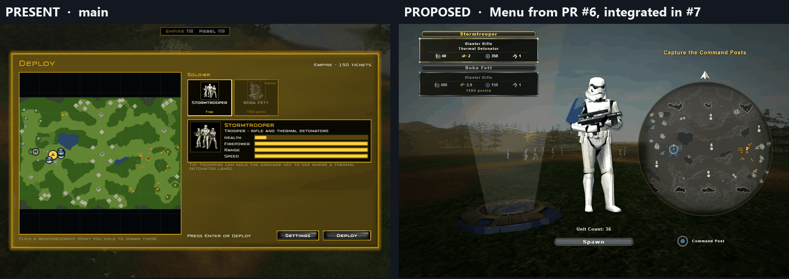

# Empire War Remastered

Empire War Remastered is **0xHayd3n’s experimental fork of [Empire at War: Browser Edition](https://github.com/Glenn332/Empire-At-War-Browser-Edition)**. The goal is to make the same battle worth seeing at two scales: move a squad through the undergrowth on Endor, then pull back and command the whole field. The fork also gives stock and installed Workshop factions a shared place to choose a campaign, paint an army, or set up a land or space battle.

**This repository is the current public development build. There’s no official Remastered release.** `nightly` is simply the default branch you get when you clone it. It contains playable features alongside unfinished work; settings, saves and mod compatibility can change. Bring your own *Empire at War – Gold Pack*: the game and Workshop mods are not included.

[Run it locally](#run-it-locally) · [What this fork adds](#what-this-fork-adds) · [Map remasters](#seven-remastered-battlefields) · [Known limits](#compatibility-and-work-in-progress)

[](docs/battlefront/comparisons.md)

*Deploying on Endor, before and after. [Compare the shoulder camera, first-person blaster, infantry roll and vehicle HUD in motion.](docs/battlefront/comparisons.md)*

## What this fork adds

Glenn332 and the Browser Edition contributors built the browser engine, land and space battles, Galactic Conquest, multiplayer and mod loading. Here’s what **Remastered** changes on top of that foundation:

| Area | What’s different in this build |
| --- | --- |
| Land and space rendering | Rain darkens soil and paving differently; wind moves vegetation under passing cloud shadows. In space, explosions light nearby hulls and a hit on exposed armor can leave a scorch that stays with the turning ship. Compare the original look with the new effects, or upscale the battle while leaving the HUD at native resolution. [Battle lighting](docs/battle-realism.md) · [Weather](docs/immersive-weather.md) · [Hull damage](docs/hull-battle-damage.md) · [Upscaling](docs/battle-upscaling.md) · [HDR requirements](docs/hdr-output.md) |
| Tactical physics and aftermath | Rapier animates infantry ragdolls and lets vehicles and ships break into sections from their own models. A heavy vehicle can push a settled wreck; a squad can walk through a blast crater. New solo battles also use collision checks for movement, ramming and projectile hits. Cosmetic debris does not deal damage, and old replays and multiplayer keep their existing movement rules. [Physics and fallbacks](docs/mod-death-physics.md) · [Walkable craters](docs/land-craters.md) |
| Battlefront ground combat | Choose a class and a friendly command post on the deployment map. Fight with an over-the-shoulder sight or a first-person blaster fitted to a supported rig; vehicles get their own chase camera. The HUD places target health, radar and capture progress around the fight. The original deployment layout is still selectable. [Side-by-side comparisons](docs/battlefront/comparisons.md) |
| Command desk, Army Painter and fleet registry | Resume an eligible conquest save from Home or find a skirmish on the battlefield chart. Rotate a mounted ship or soldier in **Army Painter**, choose four colors and a pattern, and equip the livery without changing stats or team indicators. Save fleet presets separately. Faction crests and commander figures identify which roster you’ve picked. [Army Painter](docs/army-painter.md) · [Fleet registry](docs/unit-armory.md) · [Commander heraldry](docs/commander-heraldry.md) |
| Universal campaigns and Workshop | Browse campaigns across installed eras by faction, start period and planet count, then launch one under its own scripts, rules and save profile. Optional objectives on eligible starts include a Hoth–Bespin freighter escort, derelict recovery at Sullust and a Rebel flagship that carries damage between battles. Workshop playsets preserve mod order without replacing a running Universal session. [Campaigns and objectives](docs/universal-library.md) · [Workshop playsets](docs/workshop-exchange.md) |
| Cross-era tactical battles | Pick factions from different installed profiles for Skirmish or Instant Battle without merging their campaigns. One tested matchup is Revan’s Revenge’s Sith Empire against Fall of the Republic’s Trade Federation on stock Abregado-rae, on land and in space. [What crosses between mods, and which matchups were tested](docs/cross-era-tactical.md) |
| Multiplayer setup | Choose a land or space ruleset, find a compatible opponent and vote on a map before readying up. Friend codes, messages and invitations sit alongside custom rooms. Ranked results are local; this fork does not operate a public ladder. [Matchmaking](docs/play-operations.md) · [Commander network](docs/commander-network.md) |
| Settings and accessibility | Use **Settings → Video → Graphics Quality** to switch the land or space look, or adjust effects individually. Camera, key bindings, audio, HUD, accessibility, replay and campaign defaults have their own controls. Portable preferences can follow you between profiles without moving saves or network identity. [Settings inventory](docs/settings-inventory.md) |
| Storage and memory | An installed Workshop profile can now read verified data straight from its loose files and archives instead of building a second disk copy as you play. Offline copies are still optional. On the rendering side, smaller texture levels are generated in strips: on the documented 2048×2048 DXT5 test the temporary pixel buffers dropped from 20 MiB to 4.125 MiB with identical output. [How pack storage works](docs/universal-library.md#what-is-stripped) · [Texture memory measurement](docs/universal.md) |

### Seven remastered battlefields

These are optional visual rebuilds of **specific stock Forces of Corruption maps**, not seven new maps or a texture swap applied to every planet. Once the server is running, open [Endor Ultra](http://127.0.0.1:8590/#endor-ultra) and [original Endor](http://127.0.0.1:8590/#endor-original) to compare the same deployment. Neither changes your retail files; an unrecognized map revision keeps its original scenery.

| Battlefield | What to look for |
| --- | --- |
| [Endor](docs/endor-full-landscape.md) | Forest floor, thickets and understory around the deployed infantry. |
| [Yavin Training Grounds](docs/yavin-remaster.md) | Broadleaf jungle and ferns along the muster tracks; laid stone stays distinct from the forest floor. |
| [Tatooine](docs/tatooine-remaster.md) | Wind ripples at squad height that read as a continuous sandy approach from the command camera. |
| [Hoth](docs/hoth-remaster.md) | Soft snow across the flats gives way to compacted snow in the service yards. |
| [Geonosis](docs/geonosis-remaster.md) | Fine sediment over red-brown crust, with gravel gathering in washes near the spires. |
| [Naboo](docs/naboo-remaster.md) | Meadows give way to recessed stone paving at the Theed courts and palace steps. |
| [Utapau](docs/utapau-remaster.md) | Fractured banks and pebbled channels meet the straight edges of the manufactured decks. |

## Run it locally

You need your own **Gold Pack** installation (both the base game and Forces of Corruption), [Node.js 22 or later](https://nodejs.org/) with npm, and a current desktop browser such as Chrome or Edge. No Workshop subscription, texture build or native compiler is needed for stock play.

```sh
git clone https://github.com/0xHayd3n/Empire-War-Remastered.git
cd Empire-War-Remastered
npm ci
npm run universal
```

Open **[http://127.0.0.1:8590/](http://127.0.0.1:8590/)** and keep the terminal running. From Home, choose **Play → Single Player → Skirmish** for a battle, **Galactic Conquest → Galactic Civil War** for a stock campaign, or **Army Painter** to paint a unit. On Windows, `Universal Library.cmd` starts the same launcher. Stop the server with `Ctrl+C`.

- **Game not found?** The launcher checks Steam libraries. Set `SWR_GAME` to the directory containing both `GameData` and `corruption` if yours is elsewhere. `STEAM_PATH` can point it to a different Steam client for Workshop discovery.
- **Using an overhaul?** Install a supported parent mod in Steam, stop the server, run `npm run universal:build`, then restart Universal. Keep the parent installed for the default mode. For saved collections instead, `npm run workshop` opens the [collection launcher](http://127.0.0.1:8490/). [Installation and offline profiles](docs/universal-library.md#what-is-stripped)
- **Returning to a save?** Use the same browser profile, address and ports. Universal uses `8590`–`8597` on loopback; `SWR_UNIVERSAL_PORT` moves the block but does not migrate saves.
- **Updating an existing clone?** Save your own changes first. On `nightly`, run `git pull --ff-only` and `npm ci`. Coming from the earlier `remastered` checkpoint? Run `git fetch origin` and `git switch nightly` first.

## Compatibility and work in progress

The campaign library recognizes **Thrawn’s Revenge**, **Fall of the Republic**, **Revan’s Revenge**, **Awakening of the Rebellion**, **Awakening of the Clone Wars** and **Empire at War: Remake** as separate profiles. Only installed and prepared profiles can launch. A faction appearing in setup does not mean every pairing is balanced, every submod loads, or every campaign plays to completion. [Cross-era test results](docs/cross-era-tactical.md) and the [engine progress log](progression.md) spell out the limits.

For multiplayer on one computer, run `npm ci --prefix lobby` once, then `npm run relay:local` in a second terminal and use separate browser profiles. Across computers, players need matching builds, editions and mod order, plus a reachable compatible relay. [PlayEAW.com](https://playeaw.com) hosts **upstream Browser Edition**, not this build.

[Renderer experiments and proposals](docs/realism-roadmap.md) and [earlier prototypes](experiments/pre-universal/README.md) are kept separate from the playable features above. To check the source without retail files, run `npm ci` and `npm run check:nightly`. That includes a production build; it does not certify every game/mod combination. For player-facing changes, test through the mounted Universal window.

[Player guide](docs/player-guide.md) · [Map remaster workbench](docs/map-remaster-workbench.md) · [How upstream changes reach this fork](docs/nightly.md) · [Report a bug](https://github.com/0xHayd3n/Empire-War-Remastered/issues) · [Security reports](SECURITY.md)

## Credits and license

**Browser engine:** Glenn332 (RIRA) and the [Browser Edition contributors](https://github.com/Glenn332/Empire-At-War-Browser-Edition). **Remastered fork:** 0xHayd3n. The original game and expansion are by Petroglyph and LucasArts. The Workshop authors retain credit for their overhauls. Neither the retail game, Workshop payloads nor generated private packs are distributed here.

The engine code is [GPL-3.0-or-later](LICENSE), without warranty. See the bundled notices for [Rapier](public/vendor/rapier/LICENSE), [meshoptimizer](public/vendor/meshoptimizer/LICENSE.md), [three.js](public/vendor/three/LICENSE), [Fengari](public/vendor/fengari/LICENSE), [FFmpeg core and corresponding source](public/vendor/ffmpeg/SOURCE.md), [Oswald](public/fonts/oswald/OFL.txt) and [Aurebesh AF](public/fonts/aurebesh-af/NOTICE.txt). Redistributable landscape materials and vegetation are credited in [`public/art/`](public/art/), including the [Endor source notes](public/art/endor-terrain/SOURCES.md).

This is a non-commercial fan project, not an official remaster or an endorsement by Lucasfilm, Disney, Petroglyph or Electronic Arts. The code license grants no rights to *Star Wars*, the retail game data, Workshop content or the game imagery shown in the comparisons.
